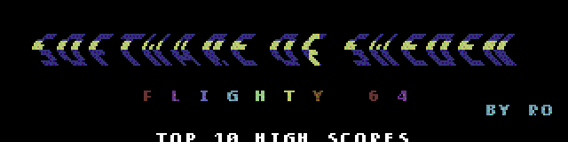
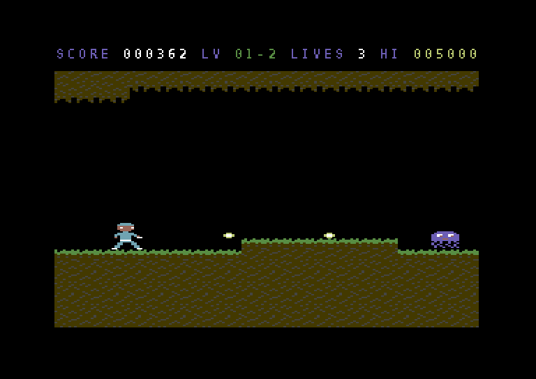
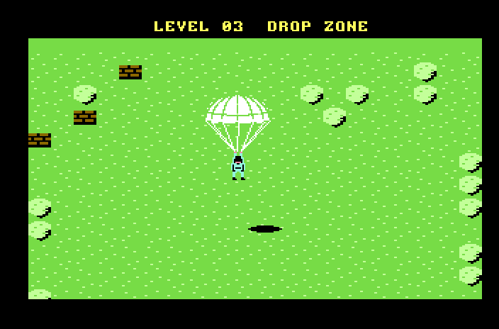
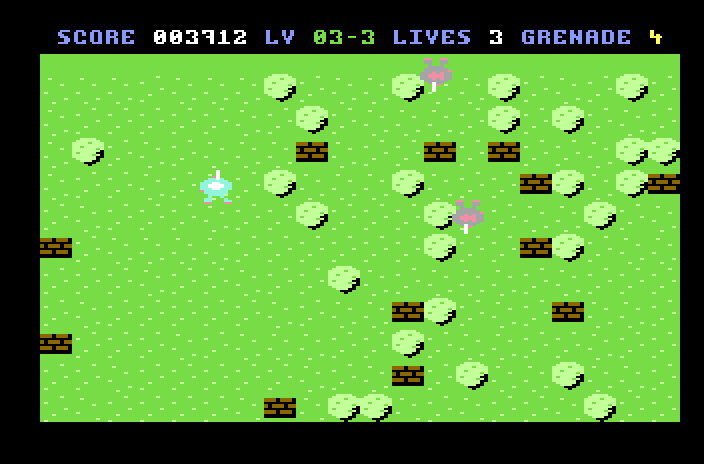
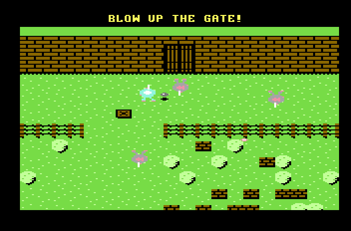
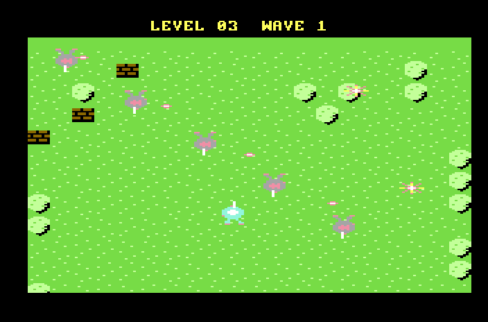
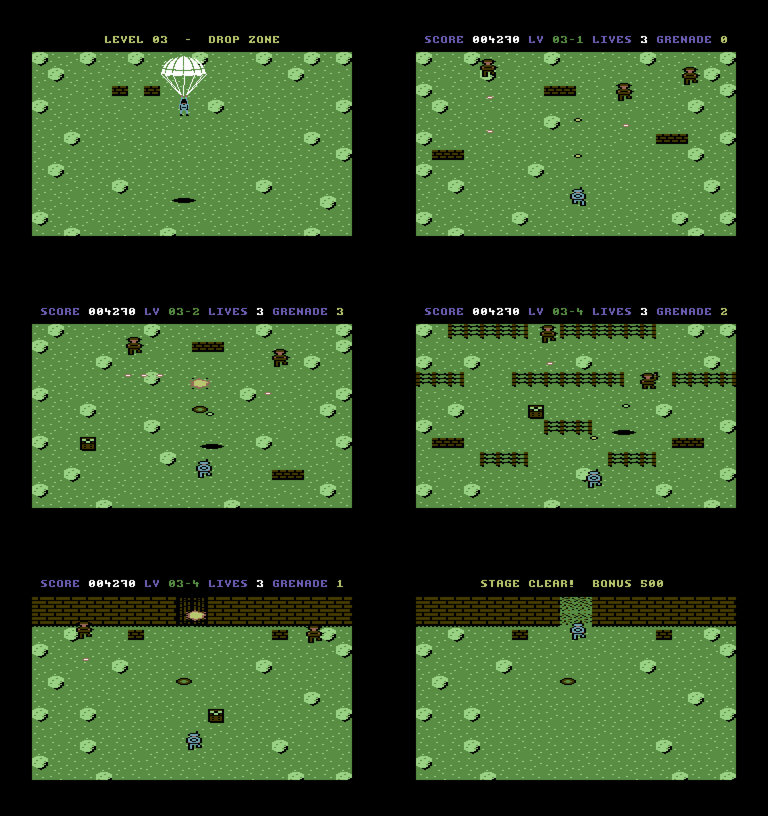

# Flighty 64

Ett grottspel för Commodore 64, skrivet i 6502-assembler för
[KickAssembler](http://theweb.dk/KickAssembler/).

Du springer genom en grotta som scrollar åt vänster. Marken och taket går
upp och ner, det finns trappsteg att hoppa upp för och gropar att hoppa över,
och monster kommer från höger: gående, svävande och hoppande. Skjut dem
framåt, bakåt, uppåt eller snett uppåt, eller hoppa över dem. Efter en stund
står ett rymdskepp och väntar på marken. Spring in i det, så flyger du vidare
genom en slingrande grotta där monstren både springer på marken och flyger i
luften. Efter flygturen landar skeppet och nästa nivå börjar, med fler monster.

Var tredje nivå är annorlunda: du hoppar ut med **fallskärm** och kämpar dig
fram över en bana som ses **ovanifrån** (se [nivå 3](#nivå-3-banan-ovanifrån)).







*(Skärmbilderna kommer från testmiljön i `tools/emu.py`, som använder ett
ersättningstypsnitt i stället för C64:ans tecken-ROM. På en riktig C64 eller i
VICE ser texten ut som vanligt.)*

---

## Så spelar du

Använd en joystick i **port 2**.

### Huvudmenyn

Överst står **SOFTWARE OF SWEDEN** i stora bokstäver. Bokstäverna böljar i
sidled: varje rasterlinje är förskjuten lite olika, så textens vänsterkant
bildar en sinuskurva som vandrar uppåt. Genom bokstäverna syns en svensk
flagga vars gula kors rör sig som en studsande basketboll sedd från sidan.
Den vågräta balken faller och studsar mot golvet i allt lägre studsar,
trycks ihop i varje nedslag och får sedan en ny knuff, som när man
dribblar. Den lodräta balken går med jämn fart i sidled och studsar
tvärt mot textens kanter, som mot en vägg, och trycks ihop där.

Under spelets titel rullar en text från höger till vänster. Den börjar med
upphovsmännen, **BY RON, WHITE KNIGHT, BEAST & WOLK**, och fortsätter med en hälsning
om att spelet gjordes för att fira SOS 40-årsjubileum. Texten står i
`scrollText` i `src/menu.asm`.

Menyn visar de **10 bästa resultaten** (namn och poäng). Det senast
inskrivna resultatet visas i gult. Starta en omgång med **FIRE**.

### Nivåer och vågor

Varje **nivå** består av en springfas och en flygfas. Varje fas har **4 vågor**
som är ungefär 13 sekunder långa. I varje våg kommer en ny blandning av monster.
Vågens nummer visas en stund på översta raden och står sedan i HUD:en som
`LV 01-2` (nivå 1, våg 2).

**Antalet monster som kan vara ute samtidigt ökar** med våg och nivå:

| Nivå | Våg 1-2 | Våg 3-4 |
|------|---------|---------|
| 1    | 2       | 3       |
| 2    | 3       | 4       |
| 3    | 4       | 5       |
| 4+   | 5       | 5       |

Monstren kommer också tätare på senare vågor och nivåer, och från nivå 3 blir
tunneln i flygfasen smalare.

### Fas 1: springa (ca 50 sekunder)

| Joystick        | Funktion                                    |
|-----------------|---------------------------------------------|
| Upp             | Hoppa (släpp tidigt för ett lägre hopp)     |
| Höger / vänster | Spring fortare eller bromsa, vänd gubben    |
| Fire            | Skjut (håll in för att skjuta automatiskt)  |

Skottets riktning beror på vad gubben gör:

| Gubben…                               | Skottet går…                        |
|---------------------------------------|-------------------------------------|
| står stilla eller springer på marken  | rakt fram eller bakåt, dit han tittar |
| hoppar (joysticken bara uppåt)        | rakt upp                            |
| hoppar och håller höger/vänster       | snett uppåt åt det hållet           |

* Du kan inte springa rakt upp för ett trappsteg. Du måste hoppa.
* Om en vägg skjuter dig ut över vänsterkanten blir du krossad.
* Ramlar du ned i en grop (med piggar i botten) förlorar du ett liv.
* Rör du ett monster förlorar du ett liv.

| Våg | Monster                                                      |
|-----|--------------------------------------------------------------|
| 1   | Gående (gröna)                                               |
| 2   | Svävande (blå) + några gående                                |
| 3   | Hoppande (orange) + gående och svävande                      |
| 4   | Alla sorter blandat                                          |

Svävarna håller sig en bit ovanför marken och guppar. De låga skjuter du
rakt fram. De höga kan du gå under, men hoppar du in i dem dör du. Skjut dem
uppåt eller snett uppåt medan du hoppar.

### Fas 2: rymdskeppet (ca 50 sekunder)

Efter springfasen planar marken ut och ett **rymdskepp** står och väntar.
Spring in i det för att kliva ombord (+100 poäng). Missar du skeppet kommer
ett nytt.

| Joystick   | Funktion                                    |
|------------|---------------------------------------------|
| Alla håll  | Styr skeppet                                |
| Fire       | Skjut rakt fram                             |
| Fire + upp | Skjut snett uppåt                           |
| Fire + ned | Skjut snett nedåt                           |

* Grottan slingrar sig upp och ner. Nuddar du taket eller golvet exploderar
  skeppet.

| Våg | Monster                                                      |
|-----|--------------------------------------------------------------|
| 1   | Flygande fladdermöss (lila)                                  |
| 2   | Fladdermöss + gående på marken                               |
| 3   | Sökminor (röda) som glider mot skeppets höjd + svävare       |
| 4   | Alla sorter blandat, även hoppare                            |

### Landning och nästa nivå

Efter flygfasens fjärde våg visas "PREPARE TO LAND". Under tiden marken
planar ut kan du flyga fritt utan att krocka med grottan. Sedan landar
autopiloten skeppet, du kliver ut och nästa nivå börjar.

### Nivå 3: banan ovanifrån






Nivå 3, 6, 9 och så vidare är en egen sorts nivå som ses ovanifrån.

* **Fallskärmshopp:** efter flygfasen på nivån innan visas "PREPARE TO JUMP".
  Sedan sjunker du ned med fallskärm mot landningsplatsen. Joysticken
  höger/vänster styr lite i sidled, och skuggan på marken visar var du landar.
* **På marken** styr du gubben åt alla åtta håll. Träd och sandsäckar stoppar
  dig. Banan rullar nedåt när du går uppåt i övre delen av skärmen, och den
  går aldrig bakåt. Det finns alltid en väg igenom.
* **Skjuta:** upp, vänster, höger eller snett upp åt vänster/höger, beroende
  på joysticken. Utan riktning går skottet uppåt.
* **Granat:** håll in fire och dra joysticken **nedåt**. Granaten kastas
  rakt uppåt, flyger i en båge (skuggan visar var den är) och smäller en bit
  framför dig. Alla soldater nära smällen dör. Antalet granater står uppe
  till höger (GRENADE).
* **Lådor** ligger på marken från våg 2. Gå på en låda så får du 4 granater
  (högst 9).
* **Soldaterna** kommer uppifrån, går en bit nedåt, stannar och skjuter och
  går sedan vidare. De går runt träd och sandsäckar.

| Våg | Vad som händer                                               |
|-----|--------------------------------------------------------------|
| 1   | Soldaterna skjuter rakt nedåt                                |
| 2   | De skjuter också snett nedåt mot dig. Lådor med granater     |
| 3   | De kastar också handgranater mot där du står                 |
| 4   | Taggtråd: hela rader med taggtråd och bara en öppning. Rör du tråden dör du |

Efter våg 4 kommer en **mur med en port**. Banan slutar rulla och det står
"BLOW UP THE GATE!". Soldaterna kommer ut genom porten. Kasta granater mot
porten: tre träffar spränger den. Har du inga granater dyker en ny låda upp
efter några sekunder. När porten sprängs dör alla soldater, du får bonus och
nästa nivå börjar efter "STAGE CLEAR".

Så här såg planen ut (mockups med spelets grafik):



### Poäng och liv

| Händelse                    | Poäng |
|-----------------------------|-------|
| Varje tecken-kolumn du tar dig fram | 1 |
| Gående monster              | 20    |
| Svävande monster            | 30    |
| Hoppande monster            | 30    |
| Fladdermus                  | 40    |
| Sökmina                     | 50    |
| Kliva in i rymdskeppet      | 100   |
| Nivå 3: varje rad du tar dig fram | 1 |
| Nivå 3: soldat              | 100   |
| Nivå 3: spränga porten      | 500 + 100 per granat kvar |

Du har **3 liv**. När du dör blinkar du en stund och kan då inte skadas av
monster (i flygfasen inte heller av grottväggarna). När liven är slut kommer
"GAME OVER". Räcker poängen till topplistan skriver du in tre tecken:
**upp/ned** byter tecken och **fire** går till nästa.

---

## Bygga och köra

Du behöver:

* Java (8 eller senare)
* [KickAssembler](http://theweb.dk/KickAssembler/) (`KickAss.jar`, version 5.x)
* En C64-emulator, till exempel [VICE](https://vice-emu.sourceforge.io/) (`x64sc`),
  eller en riktig C64

```sh
# Bygg (lägg KickAss.jar i projektmappen eller ange sökvägen)
KICKASS=/sökväg/till/KickAss.jar ./build.sh

# Bygg och starta i VICE
KICKASS=/sökväg/till/KickAss.jar ./build.sh run
```

Eller direkt:

```sh
java -jar KickAss.jar src/main.asm -o build/flighty64.prg
x64sc -autostart build/flighty64.prg
```

Programmet startar med en BASIC-rad (`10 SYS 2061`), så på en riktig C64 räcker
`LOAD"FLIGHTY64",8,1` följt av `RUN`.

Spelet är gjort för PAL-maskiner (50 Hz).

### Jämn rulltext och scrollning i VICE

En PAL-C64 ritar 50 bilder per sekund. På en skärm med 60 Hz måste VICE
visa var femte bild två gånger, och då ser rulltexten och grottan hackiga
ut, fast spelet flyttar dem exakt lika långt varje bildruta. Två sätt att
få det jämnt:

* **Ställ skärmen på 50 Hz** (i Windows skärminställningar, om skärmen
  klarar det) och kör VICE med vsync: `x64sc -VICIIvsync -autostart ...`.
  Varje bild visas då exakt en gång, i rätt takt.
* **Kör VICE i 60 bilder per sekund:** `x64sc -speed -60 -VICIIvsync
  -autostart build/flighty64.prg`. Rörelsen blir helt jämn på en 60 Hz-skärm,
  men allt går 20 % fortare (även ljudet).

---

## Projektstruktur

```
src/
  main.asm        Start, initiering, huvudloop och spelstart
  const.asm       Konstanter, minneskarta, zero page-variabler
  irq.asm         Raster-IRQ och skrivning av skuggregister till VIC
  screen.asm      Text, HUD och den dubbelbuffrade scrollningen
  cave.asm        Grottgeneratorn, ringbufferten och scrollsteget
  player.asm      Gubben (springa/hoppa), rymdskeppet, skott, död
  enemies.asm     Monster, skott, kollisioner, sprite-uppbyggnad
  sound.asm       Ljudeffekter via SID
  menu.asm        Huvudmeny med topplista, "GAME OVER"
  logo.asm        Startskärmens logo med studsande svensk flagga
  topdown.asm     Nivå 3: banan ovanifrån, fallskärmshoppet, vertikal scroll
  tdobjects.asm   Nivå 3: soldater, skott, granater, lådor, taggtråd och porten
  mux.asm         Nivå 3: sprite-multiplexer (upp till 16 sprites)
  highscore.asm   Topplistan och namninmatning
  gfx_const.asm   (genererad) spritepekare, teckenkoder, kollisionsboxar
  gfx_data.asm    (genererad) tecken- och spritedata
tools/
  make_gfx.py     Ritar om grafiken från ASCII-konst -> gfx_*.asm
  gfx_level3.py   Grafiken för nivå 3 (delas av make_gfx.py och mockup-skriptet)
  mockup_level3.py Mockups av nivå 3 -> docs/niva3/
  ka_subset.py    Liten assembler för den KickAss-syntax spelet använder (test)
  emu.py          Minimal C64-testmiljö (py65) för provkörning och skärmbilder
  smoke_test.py   Automatiskt test: meny -> nivå 1 (alla vågor) -> nivå 2 -> game over -> topplista,
                  sedan nivå 3 (hopp, multiplexer, alla vågor, porten, nivå 4). --level3 kör bara nivå 3
  vice_test.py    Samma genomspelning i riktiga VICE via den binära monitorn
  get_openroms.sh Hämtar fria C64-ROM:ar (MEGA65 Open ROMs) för VICE-testet
build.sh          Bygger med KickAssembler
```

### Ändra grafiken

All grafik ritas som ASCII-konst i `tools/make_gfx.py`:

```sh
python3 tools/make_gfx.py
```

Kommandot skriver om `src/gfx_const.asm` och `src/gfx_data.asm`. Kollisionsboxarna
räknas ut automatiskt från bilderna.

---

## Hur det fungerar

### Minneskarta

| Adress        | Innehåll                                                   |
|---------------|------------------------------------------------------------|
| `$0801-$7fff` | BASIC-rad, programkod och grafikdata (källa)               |
| `$8000-$83ff` | Skärm A (VIC-bank 2)                                       |
| `$8400-$87ff` | Skärm B                                                    |
| `$8800-$8fff` | Teckenset: 0-63 från ROM, 64-72 grottan, 88-119 och 192-239 nivå 3 |
| `$8c00-$8de7` | Logotecknen (teckenkod 128-188, byggs vid start)           |
| `$9000-$9fff` | (VIC ser tecken-ROM här, används inte för grafik)          |
| `$a000-$a97f` | Sprites (kopieras hit vid start)                           |
| `$bfff`       | Byte som VIC visar mellan rader ("tomgång"), alltid 0      |
| `$c000-$c1ff` | Ringbuffert för grottan, monster, skott, ljud, logons färger (körtid) |
| `$c200-$cbff` | Nivå 3: banan, 64 rader x 40 tecken (ringbuffert)          |
| `$cc00-$ccff` | Nivå 3: multiplexerns tabeller                             |
| `$cd00-$cd8f` | Nivå 3: soldater, fiendeskott, explosioner                 |

Grafiken ligger i VIC-bank 2 (`$dd00`). Programfilen blir då sammanhängande
utan tomrum, och koden har plats ända upp till `$7fff`. BASIC- och KERNAL-ROM
stängs av (`$01 = $35`), så spelet har hela zero page och egna
avbrottsvektorer på `$fffa-$ffff`.

### Mjuk scrollning med dubbelbuffring

* Grottan scrollas 2 pixlar per bildruta med `$d016` (finscroll, 38 kolumner).
* När finscrollen slår runt byts skärmbuffert (A ⇄ B) via `$d018`.
* Den dolda bufferten förbereds under de två följande bildrutorna: den synliga
  skärmen kopieras ett tecken åt vänster med en avrullad loop (övre halvan i
  ena bildrutan, nedre i nästa), och sedan ritas den nya kolumnen längst till
  höger.
* All logik räknar med världens läge för *nästa* bildruta. Skuggregister för
  sprites och scroll skrivs till VIC direkt efter vblank-avbrottet, så att
  sprites och bakgrund alltid flyttar sig i takt.

### Raster-avbrott

* **Linje 251** (under spelfältet): HUD-raden får ingen scroll och ingen
  multicolor. Huvudloopen får signalen att en ny bildruta börjar.
* **Linje 63** (i den tomma rad 1): byt till rätt skärmbuffert och sätt
  grottans finscroll. HUD:en står därför still medan grottan scrollar.
* På startskärmen ligger det övre avbrottet på **linje 55** i stället och kör
  logons rasterloop (se nedan).
* På nivå 3 ligger det på **linje 61**, se nedan.

### Nivå 3: vertikal scroll

* Banan byggs av block om 2x2 tecken (träd, sandsäckar, gräs ...) som läggs
  rad för rad i en ringbuffert med 64 teckenrader (`$c200`). En slumpad stig,
  fem block bred, hålls alltid fri från hinder.
* Finscrollen är `$d011` (yscroll 0-7), grovscrollen samma dubbelbuffring
  som i grottan: den synliga skärmen kopieras en rad nedåt till den dolda,
  och den nya raden ritas överst.
* HUD-raden står still. Den visas med yscroll 3 och 25 rader. Avbrottet på
  linje 61 väntar till linje 63 och sätter då spelplanens `$d011` (24 rader,
  yscroll = finscrollen). Nästa badline kommer därför först där spelplanen
  ska börja. När yscroll är 7 skulle det matcha själva linje 63, så då
  väntar avbrottet en linje till (annars kan VIC starta en badline mitt på
  linjen). 24-radsläget döljer den halva rad som scrollar in längst ned.
* Bakgrundsfärgen (gräs) slås på i vänsterkanten på samma linje, och HUD:en
  visas i 40 kolumner så att ramen inte ändrar bredd vid övergången.
* Fallskärmen är fyra vita hires-sprites (48x42 pixlar) och gubben i selen
  tre hires-sprites med en färg var på samma koordinater (svart, ljusröd,
  cyan). Tillsammans med skuggan används alla åtta sprites.
* Allt på marken (soldater, skott, granater, explosioner) har
  skärmkoordinater och flyttas en pixel nedåt varje gång banan scrollar.
  Hindren och taggtråden läses direkt ur ringbufferten, och när en låda
  plockas upp eller porten skadas skrivs nya block både i ringbufferten och
  i de två skärmbuffertarna.

### Nivå 3: sprite-multiplexer

Spelaren, 5 soldater, 4 fiendeskott, spelarens skott, två granater med
skuggor och explosioner blir fler än åtta sprites. Varje bildruta läggs alla
i en lista med "virtuella" sprites (högst 16):

* Listan sorteras uppifrån och ned (insättningssortering, oftast redan nästan
  sorterad).
* De åtta översta skrivs till VIC i vblank som vanligt.
* Nummer 9 och uppåt återanvänder hårdvarusprite *n* & 7. Ett raster-avbrott
  på linjen efter att den förra spriten i samma hårdvarusprite har ritats
  klart skriver om x, y, pekare (i båda skärmbuffertarna), färg, multicolor-
  och x-bit. Ligger spriten närmare än 24 linjer under den förra visas den
  inte den bildrutan.
* Schemat byggs i huvudloopen och kopieras i vblank till tabellerna som
  avbrotten läser, så att avbrotten aldrig ser ett halvfärdigt schema.

### Startskärmens logo

* **Bokstäverna** byggs när programmet startar, från C64:ans egna ROM-tecken.
  Varje pixel blir 2×3 pixlar, så en bokstav blir 16×24 pixlar (2×3 tecken).
  Tecknen är **inverterade**: förgrunden är svart runt bokstaven, och själva
  bokstaven är ett hål där bakgrundsfärgen `$d021` syns.
* **Vågen i sidled:** raster-avbrottet på linje 55 kör en loop över
  rasterlinjerna 58-84. För varje linje skriver den `$d016` (finscroll 0-7
  pixlar ur `waveTab`) och `$d021` (blått eller gult). Fasen ökar 3 steg
  per linje och 1 steg per bildruta, så vågen vandrar. Logoraderna visas i
  38-kolumnsläge, så kanten som avslöjas när en linje flyttas döljs.
* **Tidpunkten** (uppmätt i VICE): på vanliga linjer skrivs `$d016` först,
  senast cykel 12. Ändras finscrollen medan bilden ritas blir det lösa
  pixlar i bakgrundsfärgen. `$d021` kommer strax efter; bakgrunden syns
  ändå inte förrän i bokstäverna. På en badline (första linjen i varje
  teckenrad) står CPU:n still från första läsningen efter cykel 12 till
  cykel 55. Badlinens värden skrivs därför i högerkanten på linjen före
  (fönstret är smalt: efter bildfönstret men före cykel 12, annars får hela
  badlinen förra linjens färg), och värdena för linjen efter badlinen
  skrivs i badlinens högerkant, direkt efter stoppet.
* **Den vågräta gula balken:** vilka linjer som är gula läses ur
  `bounceTop` (översta raden) och `bounceH` (tjockleken), en bildruta i
  taget. Tabellerna räknas ut i `tools/make_gfx.py`: fyra parabelstudsar
  (konstant tyngdkraft) med höjden 19, 13, 8 och 4 rader, där tiden i
  luften växer med roten ur höjden. I golvkontakten är balken 3 och sedan
  4 rader tjock (ihoptryckt), nära golvet där farten är hög 6 rader
  (utsträckt), annars 5. Serien är 139 bildrutor (ca 2,8 s) och börjar om.
* **Den lodräta gula balken** är sprite 0, höjdförstorad och placerad
  *bakom* förgrunden (`$d01b`). Den syns därför bara genom bokstavshålen.
  Den går 1 pixel per bildruta och vänder tvärt vid textens kanter. Vid
  väggen står den still i 3 bildrutor som en smalare sprite (4 pixlar i
  stället för 6, `SPR_FLAGBAR4`) med kanten kvar mot väggen.
* **Rulltexten** på rad 6 har egen finscroll: samma rasterloop sätter `$d016`
  för rasterlinje 99-106 och återställer den på linje 107. Båda är badlines,
  så värdena skrivs i högerkanten på linjen före (`d016AtLineEnd`). Raden
  visas i 38-kolumnsläge, så tecknen glider in och ut under ramen.
* Tillsammans blir rörelserna en bollbana: bågar mellan golvet och
  väggarna. Ett varv fram och tillbaka tar ca 11 sekunder.

### Grottgeneratorn

Varje kolumn beskrivs av antal takrader och golvrader. De senaste 64 kolumnerna
ligger i en ringbuffert tillsammans med färdiguträknade pixelhöjder, så att
kollisioner mot berget bara är en tabelluppslagning.

* **Springfasen:** segment på 3-10 kolumner med trappsteg (1-2 rader), ändringar
  i taket och gropar som är 3-4 kolumner breda. Öppningen är alltid minst 10 rader.
* **Landningen** (före och efter flygfasen): marken planar ut till en jämn yta.
* **Flygfasen:** generatorn väljer nya mål för tak och golv och glider mot dem
  ett steg varannan kolumn. Det ger en slingrande tunnel som är 7-11 rader hög.

Slumptalen kommer från en 16-bitars Galois-LFSR. Menyn drar slumptal varje
bildruta, så varje omgång blir olika beroende på när man trycker fire.

### Fysik och kollisioner

* Gubbens höjdled räknas i 8.8-fixtal (gravitation ≈ 0,22 px/bildruta²,
  hopphastighet −4,25 px/bildruta), vilket räcker för att hoppa ca 5 tecken högt.
* Kollision mot berget görs mot golv- och takhöjden i kolumnerna under
  gubbens vänstra och högra kant.
* Kollisioner mellan sprites (skott, monster, spelare, skepp) är
  boxkollisioner i 16-bitars x-led. Hårdvarukollisionerna används inte.
* Skotten har en egen hastighet i x och y (`B_DX`/`B_DY`). Riktningen väljs
  ur en tabell med åtta riktningar (`shotDX`/`shotDY` i `player.asm`).
* Varje monstertyp har en egen rörelse- och startrutin som anropas via
  hopptabeller (`moveTab`/`spawnTab`). Vilka typer som kommer i en våg står i
  `spawnTypes` i `enemies.asm`.

### Sprites

| Sprite | Användning                     |
|--------|--------------------------------|
| 0      | Gubben / rymdskeppet (startskärmen: flaggans lodräta balk) |
| 1-2    | Spelarens skott                |
| 3-7    | Monster (max 5), rymdskeppet på marken, explosioner |

På nivå 3 fördelas sprites av multiplexern (se ovan).

Alla sprites är multicolor (delade färger: vit och ljusröd).

---

## Testa utan C64/VICE

I `tools/` finns en liten testmiljö som kan bygga och köra spelet utan
KickAssembler och VICE (kräver Python 3, `py65` och `Pillow`):

```sh
pip install py65 pillow
python3 tools/smoke_test.py
```

`ka_subset.py` förstår bara den delmängd av KickAssembler-syntaxen som spelet
använder, och `emu.py` emulerar bara det spelet behöver (CPU, raster-IRQ,
joystick, teckenläge och sprites). Det ersätter inte ett test i VICE eller på
riktig hårdvara.

## Testa i VICE automatiskt

`tools/vice_test.py` kör spelet i riktiga VICE (`x64sc`, cykelexakt) och styr
det via VICE:s binära monitor. Skriptet stannar emulatorn en gång per
bildruta, läser spelets minne, styr gubben med samma enkla "bot" som
`smoke_test.py` och sparar skärmbilder direkt från VIC-II. Det spelar hela
vägen: menyn, alla vågor, rymdskeppet, flygfasen, landningen och nivå 2.
Sedan hoppar det till slutet av nivå 2 och spelar nivå 3 (fallskärmen och
banan ovanifrån, med en bot som söker väg runt hindren) fram till nivå 4.
Det fungerar utan skärm; finns ingen startas en virtuell skärm (Xvfb).

```sh
sudo apt install vice xvfb      # eller motsvarande
pip install pillow
tools/get_openroms.sh           # fria ersättnings-ROM:ar (se nedan)
python3 tools/vice_test.py --roms build/openroms
# skärmbilder hamnar i build/vice/
```

VICE behöver C64:ans ROM:ar (KERNAL, BASIC, teckengenerator). Originalen är
upphovsrättsskyddade och saknas i t.ex. Ubuntus VICE-paket. `get_openroms.sh`
hämtar därför [MEGA65 Open ROMs](https://github.com/MEGA65/open-roms), som är
fria (LGPL-3). Spelet stänger av KERNAL och BASIC direkt, så det enda som
märks är att typsnittet (även logons bokstäver) ser lite annorlunda ut. Har
du en vanlig VICE-installation med originalens ROM:ar kan du peka på dem i
stället (se hjälptexten i skriptet).

## Begränsningar

* Topplistan sparas inte på disk. Den finns kvar tills datorn stängs av eller
  återställs.
* Bara joystick i port 2 stöds.
