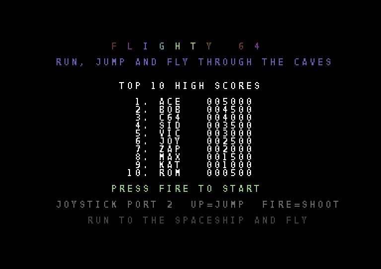
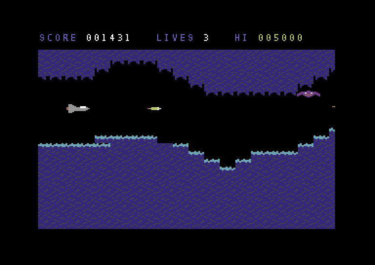

# Flighty 64

Ett grottspel för Commodore 64, skrivet i 6502-assembler för
[KickAssembler](http://theweb.dk/KickAssembler/).

Du springer genom en grotta som scrollar åt vänster. Marken och taket går
upp och ner, det finns trappsteg att hoppa upp för och gropar att hoppa över,
och små monster kommer springande från höger. Skjut dem eller hoppa över dem.
Efter en stund står ett rymdskepp och väntar på marken. Spring in i det, så
flyger du vidare genom en slingrande grotta där monstren både springer på
marken och flyger i luften.





*(Skärmbilderna kommer från testmiljön i `tools/emu.py`, som använder ett
ersättningstypsnitt i stället för C64:ans tecken-ROM. På en riktig C64 eller i
VICE ser texten ut som vanligt.)*

---

## Så spelar du

Använd en joystick i **port 2**.

### Huvudmenyn

Menyn visar de **10 bästa resultaten** (namn och poäng). Det senast
inskrivna resultatet visas i gult. Starta en omgång med **FIRE**.

### Fas 1: springa

| Joystick       | Funktion                                      |
|----------------|-----------------------------------------------|
| Upp            | Hoppa (släpp tidigt för ett lägre hopp)       |
| Höger / vänster| Spring fortare eller bromsa                   |
| Fire           | Skjut (håll in för att skjuta automatiskt)    |

* Du kan inte springa rakt upp för ett trappsteg. Du måste hoppa.
* Om en vägg skjuter dig ut över vänsterkanten blir du krossad.
* Ramlar du ned i en grop (med piggar i botten) förlorar du ett liv.
* Gröna monster kommer gående från höger. Skjut dem eller hoppa över dem.
  Rör du ett monster förlorar du ett liv.

### Fas 2: rymdskeppet

Efter ungefär 25 sekunder planar marken ut och ett **rymdskepp** står och
väntar. Spring in i det för att kliva ombord (+100 poäng). Missar du skeppet
kommer ett nytt.

| Joystick   | Funktion                                    |
|------------|---------------------------------------------|
| Alla håll  | Styr skeppet                                |
| Fire       | Skjut                                       |

* Grottan slingrar sig upp och ner. Nuddar du taket eller golvet exploderar
  skeppet.
* Nu kommer både **gående** (gröna) och **flygande** (lila) monster.
* Svårigheten ökar med tiden: monstren kommer tätare och grottan blir smalare.

### Poäng och liv

| Händelse                    | Poäng |
|-----------------------------|-------|
| Varje tecken-kolumn du tar dig fram | 1 |
| Gående monster              | 20    |
| Flygande monster            | 40    |
| Kliva in i rymdskeppet      | 100   |

Du har **3 liv**. När du dör blinkar du en stund och kan då inte skadas av
monster (i flygfasen inte heller av grottväggarna). När liven är slut kommer
"GAME OVER". Räcker poängen till topplistan skriver du in tre tecken:
**upp/ned** byter tecken och **fire** går till nästa.

---

## Bygga och köra

Du behöver:

* Java (8 eller senare)
* [KickAssembler](http://theweb.dk/KickAssembler/) (`KickAss.jar`, version 5.x)
* En C64-emulator, till exempel [VICE](https://vice-emu.sourceforge.io/) (`x64sc`),
  eller en riktig C64

```sh
# Bygg (lägg KickAss.jar i projektmappen eller ange sökvägen)
KICKASS=/sökväg/till/KickAss.jar ./build.sh

# Bygg och starta i VICE
KICKASS=/sökväg/till/KickAss.jar ./build.sh run
```

Eller direkt:

```sh
java -jar KickAss.jar src/main.asm -o build/flighty64.prg
x64sc -autostart build/flighty64.prg
```

Programmet startar med en BASIC-rad (`10 SYS 2061`), så på en riktig C64 räcker
`LOAD"FLIGHTY64",8,1` följt av `RUN`.

Spelet är gjort för PAL-maskiner (50 Hz).

---

## Projektstruktur

```
src/
  main.asm        Start, initiering, huvudloop och spelstart
  const.asm       Konstanter, minneskarta, zero page-variabler
  irq.asm         Raster-IRQ och skrivning av skuggregister till VIC
  screen.asm      Text, HUD och den dubbelbuffrade scrollningen
  cave.asm        Grottgeneratorn, ringbufferten och scrollsteget
  player.asm      Gubben (springa/hoppa), rymdskeppet, skott, död
  enemies.asm     Monster, skott, kollisioner, sprite-uppbyggnad
  sound.asm       Ljudeffekter via SID
  menu.asm        Huvudmeny med topplista, "GAME OVER"
  highscore.asm   Topplistan och namninmatning
  gfx_const.asm   (genererad) spritepekare, teckenkoder, kollisionsboxar
  gfx_data.asm    (genererad) tecken- och spritedata
tools/
  make_gfx.py     Ritar om grafiken från ASCII-konst -> gfx_*.asm
  ka_subset.py    Liten assembler för den KickAss-syntax spelet använder (test)
  emu.py          Minimal C64-testmiljö (py65) för provkörning och skärmbilder
  smoke_test.py   Automatiskt test: meny -> springa -> flyga -> game over -> topplista
build.sh          Bygger med KickAssembler
```

### Ändra grafiken

All grafik ritas som ASCII-konst i `tools/make_gfx.py`:

```sh
python3 tools/make_gfx.py
```

Kommandot skriver om `src/gfx_const.asm` och `src/gfx_data.asm`. Kollisionsboxarna
räknas ut automatiskt från bilderna.

---

## Hur det fungerar

### Minneskarta

| Adress        | Innehåll                                                   |
|---------------|------------------------------------------------------------|
| `$0400-$07ff` | Skärm A                                                    |
| `$0801-$1fff` | BASIC-rad och programkod                                   |
| `$2000-$27ff` | Teckenset (tecken 0-63 kopieras från ROM, 64+ är grottan)  |
| `$2800-$2bff` | Skärm B                                                    |
| `$3000-$33ff` | Sprites och sinustabell                                    |
| `$c000-$c1ff` | Ringbuffert för grottan, monster, skott, ljud (körtid)     |

BASIC- och KERNAL-ROM stängs av (`$01 = $35`), så spelet har hela zero page
och egna avbrottsvektorer på `$fffa-$ffff`.

### Mjuk scrollning med dubbelbuffring

* Grottan scrollas 2 pixlar per bildruta med `$d016` (finscroll, 38 kolumner).
* När finscrollen slår runt byts skärmbuffert (A ⇄ B) via `$d018`.
* Den dolda bufferten förbereds under de två följande bildrutorna: den synliga
  skärmen kopieras ett tecken åt vänster med en avrullad loop (övre halvan i
  ena bildrutan, nedre i nästa), och sedan ritas den nya kolumnen längst till
  höger.
* All logik räknar med världens läge för *nästa* bildruta. Skuggregister för
  sprites och scroll skrivs till VIC direkt efter vblank-avbrottet, så att
  sprites och bakgrund alltid flyttar sig i takt.

### Raster-avbrott

* **Linje 251** (under spelfältet): HUD-raden får ingen scroll och ingen
  multicolor. Huvudloopen får signalen att en ny bildruta börjar.
* **Linje 63** (i den tomma rad 1): byt till rätt skärmbuffert och sätt
  grottans finscroll. HUD:en står därför still medan grottan scrollar.

### Grottgeneratorn

Varje kolumn beskrivs av antal takrader och golvrader. De senaste 64 kolumnerna
ligger i en ringbuffert tillsammans med färdiguträknade pixelhöjder, så att
kollisioner mot berget bara är en tabelluppslagning.

* **Springfasen:** segment på 3-10 kolumner med trappsteg (1-2 rader), ändringar
  i taket och gropar som är 3-4 kolumner breda. Öppningen är alltid minst 10 rader.
* **Landningen:** marken planar ut till en jämn yta där skeppet står.
* **Flygfasen:** generatorn väljer nya mål för tak och golv och glider mot dem
  ett steg varannan kolumn. Det ger en slingrande tunnel som är 7-11 rader hög.

Slumptalen kommer från en 16-bitars Galois-LFSR. Menyn drar slumptal varje
bildruta, så varje omgång blir olika beroende på när man trycker fire.

### Fysik och kollisioner

* Gubbens höjdled räknas i 8.8-fixtal (gravitation ≈ 0,22 px/bildruta²,
  hopphastighet −4,25 px/bildruta), vilket räcker för att hoppa ca 5 tecken högt.
* Kollision mot berget görs mot golv- och takhöjden i kolumnerna under
  gubbens vänstra och högra kant.
* Kollisioner mellan sprites (skott, monster, spelare, skepp) är
  boxkollisioner i 16-bitars x-led. Hårdvarukollisionerna används inte.

### Sprites

| Sprite | Användning                     |
|--------|--------------------------------|
| 0      | Gubben / rymdskeppet           |
| 1-2    | Spelarens skott                |
| 3-7    | Monster, rymdskeppet på marken, explosioner |

Alla sprites är multicolor (delade färger: vit och ljusröd).

---

## Testa utan C64/VICE

I `tools/` finns en liten testmiljö som kan bygga och köra spelet utan
KickAssembler och VICE (kräver Python 3, `py65` och `Pillow`):

```sh
pip install py65 pillow
python3 tools/smoke_test.py
```

`ka_subset.py` förstår bara den delmängd av KickAssembler-syntaxen som spelet
använder, och `emu.py` emulerar bara det spelet behöver (CPU, raster-IRQ,
joystick, teckenläge och sprites). Det ersätter inte ett test i VICE eller på
riktig hårdvara.

## Begränsningar

* Topplistan sparas inte på disk. Den finns kvar tills datorn stängs av eller
  återställs.
* Bara joystick i port 2 stöds.
